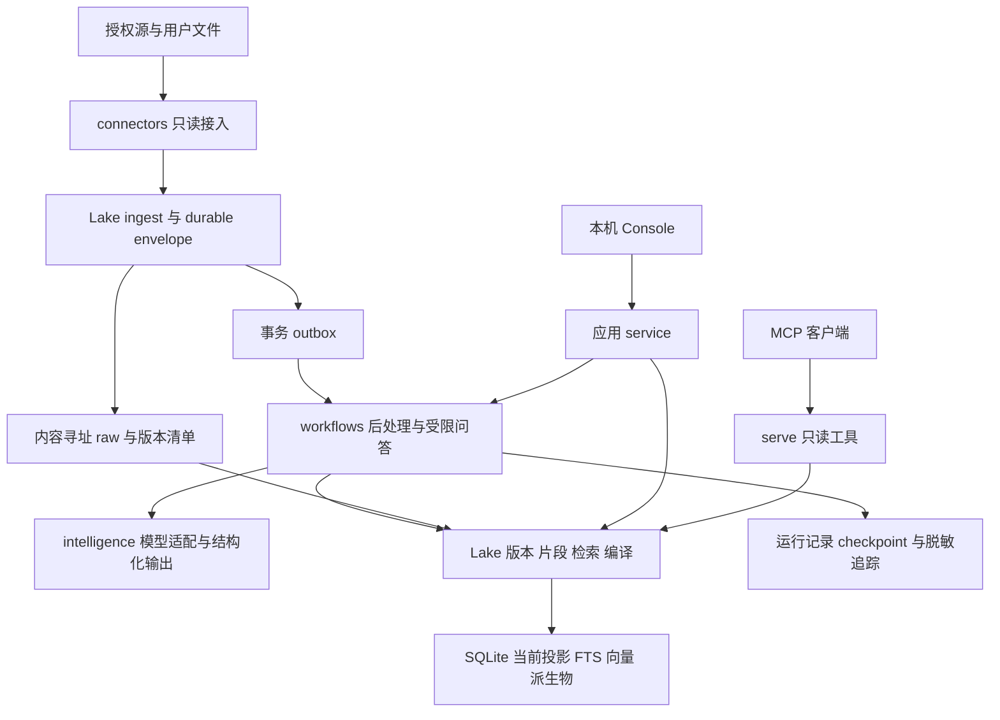

# Evidplane 技术路线与产品架构

日期：2026-10-28（Asia/Shanghai） · 基线：`31f912f` · 状态：设计草案，实施范围待确认。对应 [SPEC-0004](specs/0004-evidence-intelligence-roadmap.md)。

Evidplane 的下一阶段应围绕个人工程工作的证据与上下文构建：把分散资料变成可定位原文、可查看历史、可按任务编译、可被 Agent 稳定消费的上下文。技术深度集中在证据版本、引用与数据血缘、检索与上下文选择、任务恢复和效果评测。

建议保留 Python、SQLite、OpenDAL、MCP 和现有本机工作台；按阶段复用向量检索、重排、结构化模型输出及 LangGraph。新模块和依赖均是候选设计；当前 [架构约束](ARCHITECTURE.md) 在对应实施 spec 获准前继续有效。

## 1 产品目标与差异化

### 1.1 核心用户与任务

首期服务个人工程师，围绕一个项目持续完成三类任务：

| 场景 | 用户输入 | 产品结果 | 核心技术 |
|---|---|---|---|
| 恢复工作上下文 | “我上次在处理什么，下一步是什么？” | 任务相关资料、未决问题、时间与引用，能复制给编程助手 | 任务检索、时态过滤、上下文编译 |
| 理解决策变化 | “这个方案为什么改了，哪些记录互相冲突？” | 版本时间线、不同主张及各自证据；资料不足时明确缺口 | 不可变版本、段落引用、冲突候选与审核 |
| 整理可交付结论 | “为这个技术问题整理一份有依据的设计简报” | 可编辑结论、逐条证据、待确认项和可追踪的执行过程 | 受限问答 Agent、结构化输出、验证与运行记录 |

先把一条链路做完整：资料进入 → 找到相关证据 → 编译上下文 → 使用/更正 → 在资料更新后识别失效。首个纵向产品应让用户完成“导入一篇项目记录，追问一个问题，逐句检查来源，再把工作包交给 MCP 客户端”。

### 1.2 技术投入如何体现在产品中

| 产品能力 | 用户看到的行为 | 自有能力 |
|---|---|---|
| 证据详情 | 点击引用定位到当时版本的原文段落；可切换最新版本 | 版本/片段标识、来源定位 |
| 任务上下文 | 固定/排除某条证据；解释为什么被选入，哪些资料因预算遗漏 | Context Compiler、可解释选择计划 |
| 变化与冲突 | 显示“原记录与新记录的分歧”，不自动抹平 | 时态证据、依赖失效、候选主张 |
| 运行面板 | 看见检索、读取、生成、校验阶段；可取消、重试和恢复 | 有界执行、checkpoint、幂等提交 |
| 知识审核 | 确认、驳回或修正抽取出的决定/待办；保留原始出处 | Claim 生命周期和人工反馈 |
| 质量与使用量 | 同时看见来源覆盖、缺口、延迟、调用量和预算 | Eval、运行追踪、计量 |

“回答有引用”只是起点。引用是否指向正确版本、引用段落是否支持结论、更新后旧结论是否还能被当作当前结论，是不同问题，需分别处理。

## 2 当前基础与必须补齐的缺口

以下为仓库代码现状；上一轮完整验证为 42 项单元、9 组 L0 smoke 和浏览器验收通过，见 [整体评审](reviews/2026-10-28-project-review.md)。本次设计不重新把这些结果解释为 LLM 效果测试。

| 当前能力 | 代码证据 | 演进缺口 |
|---|---|---|
| 内容寻址 raw、幂等入库 | `lake/raw_store.py`、`lake/ingest.py` | raw 保存平台 payload，但没有足够的归一化 envelope 支持完整 raw-only replay |
| 来源、最新 items、raw_objects | `lake/schema.sql`、`lake/db.py` | item_id 全局唯一；source instance 身份、完整历史元数据、删除/断源事件未闭环 |
| get 返回正文和 provenance | `lake/query.py:get` | get(item_id) 返回最新内容；已有引用未固定不可变版本及正文位置 |
| FTS/中文子串与时间过滤 | `lake/query.py:search` | 按时间排序；没有片段级相关性、语义召回、重排及增益评测 |
| pack 有预算和 cites | `lake/query.py:pack_work` | 最多查近期50项，逐项截取600字符；无任务问题、覆盖优化、精确 tokenizer 或选择解释 |
| 本地 Web + MCP | `console/`、`serve/mcp_server.py` | 没有推理、持续任务状态、流式阶段和运行追踪 |
| 离线召回样本 | `data/eval/` | 3页面/15查询；hit@1=1.0 不能代表真实资料、中文语义或多跳回答效果 |
| DB + raw 备份恢复 | `scripts/workspace.py` | 不是 raw-only 重建；未来 checkpoint/运行状态也不能假定已在现有备份中 |

时间字段还需要拆分：connector 常把源 `last_edited_time` 放入 captured_at，而手动资料使用本次导入时间。后续必须区分源修改时间、系统观察时间与业务有效时间，不能把已有字段直接视作完整时态模型。

### 2.1 当前机器的设计约束

本次读取到的 WSL 环境为 Ryzen AI 9 HX 370、24个逻辑 CPU、约15 GiB可见内存；读取时可用约10 GiB、磁盘可用约793 GiB。这是一次环境快照，不能作为固定容量承诺。未检出可用 nvidia-smi，ROCm/Vulkan/NPU 加速未验证。

首期按 CPU 路径设计：一个 Web 进程、一个受限 worker、SQLite 和本地 raw；embedding 小模型、低批量索引、前台任务优先。模型权重下载、模型外发与推理服务接入均需要对应阶段授权。先测单用户负载，再决定服务拆分和硬件投入。

## 3 目标架构与模块边界



图中的 workflows / intelligence 是拟新增的逻辑包，不是预先拆出的网络服务。现有导入许可需在实施时同步收紧检查，不通过动态导入绕过规则。

| 模块 | 职责 | 允许方向 | 不承担的职责 |
|---|---|---|---|
| connectors | 授权只读拉取、source revision/cursor、源格式转换 | 平台 SDK、共享输入契约 | 模型推理、索引写入、MCP |
| lake | raw/envelope、版本、片段、检索适配、确定性编译、派生提交 | 存储/检索库及自有数据契约 | 平台 API、LLM 网络调用、Agent 循环 |
| intelligence | 生成/抽取、embedding/reranker 适配、prompt/schema、计量 | 已启用模型服务或本地推理 | 直接批准事实、直接改写 raw/索引 |
| workflows | 后处理、问答状态机、取消/恢复、调用策略 | Lake 公共接口、intelligence、运行时适配 | 另存一份权威证据、通用 shell 自治 |
| Console service | 用户任务、资料接入、人工审核、运行交互 | connector、Lake、workflow 公共接口 | 在 HTTP routes 中操作 SQL 或源密钥 |
| serve | search/get/pack、版本/pack 查询的薄适配 | Lake 公共查询 | 默认发起付费推理或后台平台写操作 |

第一版不再创建通用插件平台、动态 SQL Agent 或跨 Agent 消息总线。接口先围绕实际任务确定，稳定后才开放更多扩展点。

## 4 证据版本和可重建的数据模型

### 4.1 身份必须分层

| 对象 | 标识与内容 | 必须保持的关系 |
|---|---|---|
| SourceInstance | 某个授权账号/库/日历/文件导入集合 | 与 connector 类型分开；不同实例不能因平台 ID 相同而覆盖 |
| Item | 稳定逻辑条目；内部可用 UUID，对外保留旧 item_id 映射 | 指向一个或多个不可变源版本 |
| SourceVersion | 来源身份、源 revision（如有）、raw hash、源元数据 | 反映捕获到的源内容；归一化器升级不伪装成源修改 |
| DocumentVersion | SourceVersion + normalizer recipe + 归一化快照 hash | 冻结正文、标题、URL、provenance 与时间语义，可独立回放 |
| Segment | DocumentVersion + parser/splitter recipe + 文本范围 | 片段和版面坐标均可追到该文档版本 |
| Claim | 候选结论/决定/待办 + 支持/反对的 segment refs | 与源事实、模型推断和审核状态分开 |
| ContextPack | 请求、输入快照、选择计划、正文/引用与编译 recipe | 产物内容不可变；当前可用性由独立状态投影表示 |
| Run | 计划、输入快照、步骤、计量、checkpoint refs、提交结果 | 运行状态不替代证据版本和审核记录 |

同一个 raw hash 不能直接充当所有对象的 version_id：源元数据变化、人工审核变化、归一化器升级和重复观察是不同事件。业务审核采用独立事件/投影，不能通过修改旧原文来实现。

旧 item_id 别名固定映射到原逻辑条目，不重新分配。新的同平台 ID 来自另一个 SourceInstance 时取得新的内部身份；不能借迁移把旧 MCP ID 指向另一份资料。

### 4.2 版本 envelope 与回放

新增 durable envelope，至少保存：schema_version、source_instance_id、平台原始 ID/源 revision、raw hash/URI、归一化快照及其 hash、normalizer recipe、来源 URL、provenance 和明确的时间字段。重复观察放 observation 记录，避免每次拉取时间变化都产生“源内容更新”。

写入顺序：发布不可变 payload → 发布自包含 envelope → SQLite 事务登记版本/当前投影/outbox → 提交后异步建立片段和索引。游标只越过已确认持久化的数据；部分失败保留失败目标，不能用整批成功游标跳过。对象与 SQLite 之间仍是至少一次 + 幂等恢复，不宣称跨存储原子事务。

源删除、403失权、分页失败和暂时未发现不是同一事件。只有显式删除标记或完整且成功的受控范围对账，才触发相应 tombstone；失败批次不能把未拉到的页面当作已删除。增量时间范围应允许重叠和幂等处理，避免只靠本机时间推进游标漏数据。

回放只依赖 export manifest、envelope 和被引用对象，必须在断网/空数据库中恢复版本、来源、最新投影和 FTS。向量或 LLM 派生物可恢复已导出的产物，或在取得同一模型/recipe 后重建；没有这些条件时标记待重算，而不是把无法复现的内容视为成功恢复。

旧 raw 若只有 payload，尝试使用旧 DB/导出元数据补 envelope；无法补齐的字段与历史缺失单列报告，不编造 provenance。旧 item_id 和 URI 保留，迁移前后用映射与计数/hash 对照验证。

### 4.3 时间与引用

分别记录 source_modified_at、observed_at 和 valid_from/to。`known_at` 表达“系统当时知道什么”，`valid_at` 表达“内容在什么业务时间有效”。未知有效期保持未知，时间顺序不自动等于事实优先级。

引用结构至少是 `{item_id, source_version_id, document_version_id, segment_id, start, end, quote_hash, source_url}`。start/end 针对版本化 canonical text 的 Unicode code point、0起点、右端不含；规范化规则和换行处理计入 recipe。UI 可以额外使用页码/bbox，但必须保留文本引用，避免跨 Python/浏览器字符计数差异造成错位。

手动资料没有外部 URL 时，source_url 可空，仍通过本地版本/片段 ID 回查；不能为满足引用展示而制造平台链接。

`get(item_id)` 继续读最新版本；新增 `get_version` / `get_segment` 供历史引用使用。旧 cite 明确标为未固定版本，不能悄悄升级成“已验证历史引用”。

## 5 检索路线

### 5.1 先建立可比较的候选集

```text
任务问题 + 来源/时间/可见性条件
  → 精确 ID / 标题 / 实体线索快路径
  → 词法召回 与 dense 召回
  → 同一证据版本空间内按 segment 去重与 RRF 融合
  → 可选 cross-encoder 重排
  → 同条目配额、版本选择、父段落扩展
  → 选取可引用的上下文候选
```

词法侧复用 FTS5 的 BM25 排名，补充中文分词/字符 n-gram 的候选实验；保留现有中文子串作为对照，不能把语义检索当作词法质量的替代。dense 侧首选评测 sqlite-vec，让当前单机保持少量组件。该扩展支持 KNN 元数据约束，但约束操作有范围限制，必须验证具体查询计划，而非假定任意 SQL 过滤都能下推。[sqlite-vec 官方文档](https://alexgarcia.xyz/sqlite-vec/features/vec0.html)

来源/时间/可见性条件在各召回分支保持一致。不能先无条件取 top-k、再把无权或过期结果滤掉而声称召回完整；无法安全下推的条件，采用受控候选集合中的精确检索或明确不支持该模式。返回正文、cache 命中和 run 恢复时再校验当前策略。

初始融合采用排名而非直接相加异构分数：`RRF(d) = Σ 1 / (k + rank_i(d))`。k 与权重作为调优配置冻结，开发集调参、保留集测量。Qdrant 提供相同类别的多路融合能力，未来扩容时可复用，但并不因此成为首期必需组件。[Qdrant 官方文档](https://qdrant.tech/documentation/hybrid-queries/)

### 5.2 模型与片段策略

本机首轮候选为 multilingual-e5-small 与 BGE-M3。E5 的 query/passage 前缀与512 token长度限制要进入适配与测试；BGE-M3 可提供多语及 dense/sparse/multi-vector 表达，但首轮只接 dense 通路，避免一次叠加全部检索方式。最终选择以个人工程资料上的效果、延迟、内存和许可核验为准。[E5 模型卡](https://huggingface.co/intfloat/multilingual-e5-small/raw/main/README.md)、[BGE-M3 模型卡](https://huggingface.co/BAAI/bge-m3)

推理先复用模型卡支持的 Transformers 或 Sentence Transformers CPU 路径；按候选选取实现，固定权重 revision。ONNX/量化作为后续性能实验，须验证排序与数值偏差，不把硬件加速作为本机默认条件。

片段优先沿标题、段落、列表、代码块和日程字段切分；短笔记不强拆，代码块保留路径/符号，长文用 child 召回与 parent 扩展。片段长度以实际 embedding tokenizer 计数，不能用当前 len/4 代替。每个 embedding 保存模型 revision、维度、输入前缀、归一化和 segment recipe，不把不同模型向量混在同一索引中。

先测试“文档标题 + 标题路径 + 原段落”的确定性上下文，再评测 LLM 生成的 chunk context。Contextual Retrieval 提供了补充片段上下文的参考方法；其中模型生成部分必须标为派生检索提示，不能加入原文引用或冒充源结论。其公开实验增益不当作本项目预期收益。[Anthropic 技术文章](https://www.anthropic.com/research/contextual-retrieval)

重排只作用于有上限的候选集合。初始实验可取每路 top-50、重排 top-20，再用片段覆盖和延迟消融调整；这是待测配置，不是默认保证。多源重复、相邻片段和多个旧版本要去重，避免一个长文占满 pack。

重排可先将 `BAAI/bge-reranker-v2-m3` 作为多语候选，与“不重排”的基线比较；复用 CrossEncoder 接口，单独评测 CPU 延迟和内存。相关性分数只用于排序，不作为事实置信度。[重排模型卡](https://huggingface.co/BAAI/bge-reranker-v2-m3)

## 6 Context Compiler

### 6.1 从 pack 模板走向可解释的编译计划

输入包含 task/question、source scope、known_at/valid_at、预算、目标模型/tokenizer、是否允许模型外发，以及用户固定/排除的证据。输出分成稳定正文、精确引用、manifest 和选择解释。

编译采用以下阶段：

1. 校验请求和资料策略，确定输入快照与当前版本集合。
2. 选择低成本计划：精确查找、纯检索或需要受限推理的多跳问题。
3. 召回/重排并扩展必要父段落，保留候选来源和得分解释。
4. 按相关性、任务覆盖、重复度、时态与信任要求选取证据；对用户 pin 预留预算。
5. 优先抽取原文；有需要且已启用模型时生成带证据 refs 的候选摘要，再做引用校验。
6. 用目标 tokenizer 计数和渲染；超预算时按策略裁剪/退回，不能截断 JSON 或引用标识。
7. 生成不可变 manifest，并建立输入到产物的依赖边。

选择器初期采用贪心 + 多样性/覆盖约束，不宣称解决了最优背包问题。选择解释应能回答：为什么选这个版本、为什么排除另一条、资料缺口是什么、预算花在哪里。

### 6.2 三种产物与预算口径

| 模式 | 行为 | 在缺少模型时 |
|---|---|---|
| extractive | 原文片段 + 来源 + 选择解释 | 完整可用，作为基线 |
| brief | 原文支撑的任务简报；生成文本与原文分区 | 明确不可用或用户选择退回 extractive |
| decision_diff | 比较已捕获版本的决定/理由变化，展示冲突 | 先提供版本 diff 和原文；推断部分不伪装成已完成 |

预算分成上下文 token、预留输出 token、模型调用次数、wall time 和已配置计价的货币上限。现有 pack 的 len/4 继续标为估算；新编译接口必须说明计数针对正文还是包含工具 schema/消息包装。不能准确计算的 provider 包装留余量并标记计数口径。

同一输入快照、请求、编译计划和 renderer 下，extractive 产物应字节级可重复。LLM 生成结果保存模型/profile、prompt/schema、输入、参数和原响应引用；重新调用可能不同，复现指恢复已保存产物，不保证重新采样得到相同文本。

模型预算只覆盖可枚举的请求。模型评审、结构修复、子问题改写、embedding 与重排服务都计入运行预算；不是只计算最后一条回答。搜索热路径的既有确定性工具不因此引入隐式模型费用。

### 6.3 Manifest 与增量失效

manifest 至少记录输入 DocumentVersion/Segment 列表、query/filter、检索/模型/tokenizer recipe、包含/排除原因、预算、正文与引用 hash。pack_id 基于 canonical manifest 内容产生；创建时间、访问时间和当前 stale 状态放独立运行/状态记录，避免时间戳破坏内容寻址。

依赖 DAG 为 `SourceVersion → DocumentVersion → Segment → embedding/claim → pack → answer`。源更新使“当前投影”中的依赖产物过期；保留历史产物供仍获授权的审计查看。正常查询不把旧 pack 当作当前结果。策略撤销则阻止读取旧产物，不能借历史快照绕过权限。

构建键为输入版本集合 hash + recipe/config/model revision + scope/policy hash。优先做到“不相关资料更新不会重算这个任务”“相同输入重复生成命中同一产物”，再考虑更复杂的增量算法。LlamaIndex 的 ingestion transformation cache 可作参考/局部复用，但证据身份、失效和提交账本由本项目持有。[LlamaIndex 官方文档](https://developers.llamaindex.ai/python/framework/module_guides/loading/ingestion_pipeline/)

## 7 LLM 能力与模型接入

### 7.1 模型负责候选计算，代码负责约束

用已存在的 Pydantic 定义任务计划、候选主张、回答和引用 refs。模型输出必须通过 schema、引用范围、授权版本和预算校验；结构化 JSON 正确不等于事实正确。

| 模型任务 | 输出 | 控制方式 |
|---|---|---|
| 问题拆解 | 有上限的 QueryPlan，含检索子问题与过滤建议 | 代码裁定允许的过滤与工具；模型不能扩大资料 scope |
| 决定/待办抽取 | ClaimCandidate + supporting_segment_ids | refs 存在且范围有效；默认 proposed |
| 证据摘要 | SummaryBlock + span refs | 区分原文/摘要；无支持部分拒绝发布或转为缺口 |
| 综合回答 | AnswerDraft，逐结论 refs、冲突、未决项 | 发布前检查引用与内容覆盖，保留不确定性 |
| 语义评审 | 支持/不支持/不确定及理由 | 辅助评测或人工审核，不自我批准为真相 |

较便宜的模型负责小规模抽取/分类，能力更强的模型只用于复杂综合；用相同任务集验证是否值得升级。首轮只接一个经用户启用的生成 provider 与一个 embedding profile；模型精确 ID、上下文长度和价格在实施时从官方资料和账号实际可用性冻结，不凭“最新”决定。

### 7.2 薄模型适配与资料策略

`intelligence` 提供内部请求/响应契约，至少保存 provider/model revision、能力声明、prompt/schema 版本、输入 refs、usage、延迟、finish reason 和错误分类。优先使用供应商 SDK，重试/fallback 只能在用户允许的 provider 与资料策略中进行；不把兼容 OpenAI 的接口名当作能力完全兼容的证明。

有两个以上实际 provider、并且统一 routing/usage 已成为重复代码时，再评测 LiteLLM SDK 适配；不默认部署独立 Proxy。它提供统一模型接口、路由/fallback 和代理能力，但本项目仍需保有资料外发与预算边界。[LiteLLM 官方文档](https://docs.litellm.ai/docs/)

每个资料集合声明 `local_only` 或用户明确启用的 provider allowlist；embedding、reranker、模型评测和观测导出同样受此约束。只检查生成模型是不够的。模型无配置、额度不足、超时或 schema 修复失败时，给出明确状态；原有本地检索/extractive pack 继续可用。

货币预算必须有已配置的计价规则和预留机制；价格或 usage 缺失时显示 unknown/estimated，不伪造精确费用。仍可强制调用次数、token 与时长上限。对可能已计费但响应丢失的请求记录 ambiguous 状态，不能声称重试无重复成本。

## 8 有界且可恢复的 Agent

### 8.1 主要候选与替代方案

主要候选是 LangGraph，复用图状态 checkpoint、恢复和人工中断能力；领域内的证据、pack、审核和运行账本仍在自有模型中。checkpointer 持久化 thread 状态，不能替代原文版本或外部操作提交记录。[LangGraph persistence](https://docs.langchain.com/oss/python/langgraph/persistence)

LangGraph 中断恢复会重新执行节点，因此任何副作用都必须通过业务幂等键和提交记录去重；仅在 interrupt 后放写操作，也不能免除一般故障重试的幂等要求。[LangGraph interrupts](https://docs.langchain.com/oss/python/langgraph/interrupts)

PydanticAI 与 OpenAI Agents SDK 均列为替代评测项：前者有 durable execution 集成路径，后者提供 agent loop、tools、guardrails 和 tracing。若本项目只需要一个短的 typed tool loop，可选择更轻的方案；首期只保留一个执行循环，不把三个框架叠加。[PydanticAI 官方文档](https://pydantic.dev/docs/ai/capabilities/durable_execution/overview/)、[OpenAI Agents SDK 官方文档](https://developers.openai.com/api/docs/guides/agents/sdk)

Deep Agents 提供规划、文件系统上下文和 subagent harness，可在需要通用研究任务时对照评测；本阶段的证据问答不默认开放文件系统、shell 或动态 subagent。[Deep Agents 官方文档](https://docs.langchain.com/oss/python/deepagents/overview)

### 8.2 首个执行图

```text
validate_request → pin_snapshot → plan
    → retrieve → read_segments → sufficient?
        ├─ 否：在上限内补检索；仍不足则输出缺口
        └─ 是：compile_context → draft → validate_citations
                → [必要时人工审核] → commit_result
```

建议初始限制为单 Agent、最多3轮补检索、2次生成/修复机会、总模型调用上限6次；最终由实测调整并冻结在 profile 中。达到上限返回完整/不完整/无证据/超预算等结构化状态，保留已完成步骤，不能靠无限自我反思继续运行。

run 状态包括 queued/running/waiting_review/succeeded/failed/cancelled；步骤带 attempt、输入/输出 hash、幂等键和错误类型。前端使用带事件序号的阶段流，断线后可补取；运行进度来自持久记录，不依赖一条长 HTTP 连接存活。取消后不启动新调用，进行中的 provider 调用不一定能取消或退费。

本地初期使用一个 worker、事务 outbox/lease 领取工作、LangGraph 的本地持久 checkpoint。checkpoint 只引用版本/产物 ID，避免把整个资料库塞进运行状态。运行数据可使用独立 SQLite 文件，但不是另一套证据真相。

恢复时先校验当前策略、输入版本可用性、执行 recipe 和预算，再继续；资料过期时区分“查看历史结果”和“在当前资料上重跑”。checkpoint 与领域提交记录不一致时由幂等账本对账，不能假定恢复就意味着 exactly-once。

备份需升级 manifest，纳入运行/checkpoint 的恢复约定；可在 worker 安全点暂停后制作协调快照，恢复后重新领取 lease。现有 DB+raw 备份不能直接当作该能力已实现。跨进程高并发或多机 worker 出现后再评测 PostgreSQL/更强工作流服务。

### 8.3 工具和协议边界

首轮工具只提供 search、get_version、get_segment、compile_context 和提交候选产物；用户资料不能向 Agent 注入新的系统指令或扩大工具权限。模型不能直接获得平台 token、任意 SQL 或任意网络工具。

MCP 保留现有 search/get/pack；逐项增补版本和 pack 解释接口。新输出声明 schema，按实际协商的协议/客户端兼容返回结构化内容与文本；“工具结构化返回”和“模型结构化生成”分别校验。工具 annotations 是描述，不能作为授权机制。[MCP 工具规范](https://modelcontextprotocol.io/specification/2026-07-28/server/tools)

首期付费问答通过 Console 的明确动作发起，不把旧 pack 调用悄悄改为模型调用。若后续需要通过 MCP 启动 run，先为任务、费用授权、取消与状态查询设计独立 spec。

## 9 知识物化与长期记忆

长期记忆分为三类：不可变源证据、从证据生成的可重建知识投影，以及任务对话/checkpoint。它们分别保留出处与生命周期，不合并成一段不断被模型改写的摘要。

知识投影先覆盖工程任务中的 entity、decision、open_question、action_item。Claim 保存 source_version/segment refs、抽取 recipe、提出时间、业务有效期与审核事件。模型 score 是模型评分，未经标定不能展示为事实正确概率。

审核状态为 proposed → accepted/rejected，后续可被新的审核事件 supersede。接受候选时用版本校验，防止审核旧页面时把已更新的候选当成新事实。Agent 产物保留 `source=agent`；人工审核只增加审核来源，不能伪装成平台一手记录。

先用关系表保存 supports/contradicts/supersedes 等证据边，供任务解释和影响分析。GraphRAG 为跨文档知识图和图查询提供参考能力；只有固定多跳任务集证明增益、且更新/重建代价可接受时才引入。GraphRAG 的图抽取和全库摘要不是当前每条笔记的默认入库步骤。[Microsoft GraphRAG 官方文档](https://microsoft.github.io/graphrag/)

用户更正进入独立反馈事件，区分“检索没找到”“引用错位”“原文自身过时”“推断不成立”。这些事件进入版本化评测集，不能直接把线上每条反馈自动改写成训练标签。

人审、更正、用户 pin 与资料策略是权威业务事件，需进入可导出的持久 journal。原文 envelope 可重建原文索引，但不能凭它重新推断“用户曾批准什么”；完整工作空间恢复必须同时保留该 journal。模型重新抽取也不能替代丢失的人审记录。

## 10 自建与复用的边界

| 能力 | 主要方案 | 替代或延后条件 |
|---|---|---|
| 证据身份、envelope、引用与血缘 | 自有契约，复用 Pydantic/OpenDAL/SQLite | 不交给 Agent memory 框架作为唯一真相 |
| 词法 + 向量检索 | FTS5 + sqlite-vec，RRF 融合 | 并发/规模测试不达标再比较 Qdrant 或 PostgreSQL + pgvector |
| embedding/reranking | 适配已有模型和推理库，以 E5/BGE 为候选 | 无实测增益时维持词法；不自训通用 embedding |
| 文档解析 | 原文本保留结构；PDF/DOCX 阶段接 Docling | 只有需要文档版面时引入模型/OCR依赖，不替换已有 Notion adapter |
| 多步骤任务 | LangGraph，框架隐藏在 runtime adapter 后 | PydanticAI / Agents SDK 对照；不同时部署多个主循环 |
| 模型接入 | 小型 provider adapter + 供应商 SDK | 多 provider 的实际需求出现后评测 LiteLLM；不自建庞大网关 |
| Context Compiler | 自有输入快照、选择、解释、manifest、失效 | 可借用 splitter/cache 组件，不引入第二套权威 docstore |
| 知识与记忆 | 自有 Claim/Review 投影与证据 refs | Mem0/Letta 类候选延续产品 SPEC 的可替换内核评测，不整仓替换 |
| 观测 | OpenTelemetry 接口 + 本地运行计量 | Langfuse 可选；未授权不外发正文和 prompt |
| 质量评测 | 自有版本化任务集、确定性校验 + Ragas 辅助 | LLM judge 不作为唯一发布门槛 |
| 产品界面 | 复用现有 Console，按任务/证据/运行三种视图深化 | 只有复杂状态与交互成为维护瓶颈时再单列前端框架迁移 |

Docling 的文档表示可包含结构和来源定位，适合映射页码/bbox 到自有 segment；解析器输出仍需验证，不能把 OCR/版面推断当成无误原文。[Docling 文档模型](https://docling-project.github.io/docling/concepts/docling_document/)

OpenTelemetry 可提供 trace/span 接口；Langfuse 支持相关接入。其当前自托管包含 Web/worker 与多种存储组件，因此本机阶段先保留轻量本地事件与可选导出，不默认增加整套运维。[OpenTelemetry Python](https://opentelemetry.io/docs/languages/python/instrumentation/)、[Langfuse 观测](https://langfuse.com/docs/observability/get-started)、[Langfuse 自托管架构](https://langfuse.com/self-hosting)

## 11 评测与观测

### 11.1 固定样本和实验纪律

先建立约1000份有明确使用权限的工程资料、100个有人审标注的问题；包含中文同义表达、标识符、时间变化、相反主张、多跳任务、无答案和不可信正文。实际私人资料的采集需单独确认，初期可用公开许可/合成资料。

数据按项目/条目/版本族分组，建议60题开发、40题保留；同一证据的改写问题不能跨组泄漏。冻结 corpus、gold evidence version/span、token预算、模型profile和检索recipe。100题只是起步样本，报告分项和不确定性，不宣称代表所有工程工作。

依次消融：现有检索 → BM25/中文词法增强 → dense → RRF → reranker → Context Compiler → 有界 Agent。每步记录增益、退化案例、成本和内存，不一次装完再猜哪个组件有效。

### 11.2 初始验收门槛

以下均为**建议目标，尚未跑出的性能结果**；在 S0 冻结数据集与负载后，由实施 spec 确认。

| 维度 | 指标与初始门槛 | 验证方式 |
|---|---|---|
| 原文完整性 | 新版本 raw/envelope/引用 hash 校验100%；失败不标成功 | 损坏/缺失/重复/乱序/崩溃故障注入 |
| 可重建性 | 空库断网回放恢复全部承诺字段，旧布局缺口单列 | 固定快照导出 → 删除临时索引 → replay 对照 |
| 检索增益 | 保留集 nDCG@10 比词法基线提升至少0.05；中文语义子集 recall@10 提升至少10个百分点；精确 ID 不退化 | 同预算分项对照；样本不足或基线已饱和则补集，不靠调低门槛 |
| 引用有效性 | 发布结果的 version/span/quote 结构校验100% | 代码验证；结构有效不代表语义支持 |
| 语义支持 | 至少95%的抽样原子结论被证据支持；无答案案例能返回缺口 | 固定评审规则、人工复核；不支持/不确定单列 |
| Context 预算 | 声明 tokenizer 下全部产物不超预算；无 LLM 的相同快照编译结果一致 | 预算边界、Unicode、代码、表格、重复片段 |
| 延迟/资源 | 1万片段、单用户、warm hybrid 检索 p95 目标≤2秒；增加的本地索引/embedding worker RSS目标≤2 GiB | 本机约束线程/批量，至少200次；cold start和索引时长另外报告 |
| 任务可靠性 | 持久化步骤可恢复；幂等提交不重复；失权/过期快照不被继续发布 | 在每个可提交边界中断/取消/重启 |
| 成本 | 调用/token/时长上限可验证；货币费用记录配置版本及未知项 | mock usage和故障窗口；真实计费单独核对 |

Ragas 可辅助测量回答对检索上下文的支持程度；这类指标依赖分解和判断过程，不证明原始来源本身真实，也不能替代人工抽样。[Ragas Faithfulness](https://docs.ragas.io/en/stable/concepts/metrics/available_metrics/faithfulness/)

### 11.3 日常观测与 CI

每次 run 关联 input_snapshot、检索候选/过滤原因、pack_id、模型/prompt/schema版本、调用次数、token、延迟、错误与重试。trace 默认只保存必要 ID/hash/指标；原文、prompt和输出的外发需显式选择。run账本作为产品事实保留，观测后端故障不能使主任务失败或丢失提交记录。

普通 CI 继续离线运行 schema/引用/回放/预算/恢复与 mock-provider 测试。真实模型评测是独立、手动启用的受预算任务；未授权时不启用自动付费回归或定时同步。评测结果与数据集版本绑定，才允许把新方案设为默认。

## 12 分阶段交付


| 阶段 | 必须交付 | 用户可感知变化 | 进入下一阶段的门槛 |
|---|---|---|---|
| S0 基线 | 冻结接口/时钟/样本；分项评测与资源计量；当前行为对照 | 能看见现有搜索的缺口与稳定回归 | 测试集可复现、标签可审查，不拿15条假数据比较全部模型 |
| S1 证据基础 | SourceInstance、源/文档版本、segment、envelope、回放、增量迁移 | 历史引用不会随资料更新漂移；可从导出重建 | 版本/引用/回放/旧兼容通过；一条真实授权源的增量与失败语义单独验证 |
| S2 检索 | 词法增强、embedding adapter、sqlite-vec/RRF、可选重排 | 同义问题找到相关原文，展示相关片段 | 分项增益/延迟/内存达标；无增益的组件不进默认路径 |
| S3 编译 | 任务输入、pin/exclude、真实token预算、manifest/解释、依赖失效 | 创建可解释、可回查的任务工作包 | 无LLM基线完整可用，引用/预算/快照复现通过 |
| S4 Agent | 一个受限执行图、一个已启用provider、run/取消/恢复、逐结论引用 | 提问后看到阶段、证据和缺口，重启可恢复 | 受控样本语义支持/成本/故障恢复达标；无权限不扩大外发 |
| S5 知识 | 决定/待办/冲突候选、人工审核、增量物化和反馈 | 持续维护项目决策与未决项，看到资料变化影响 | 审核可回退；源变更能正确失效；知识功能有使用价值与独立评测 |

按阶段验收而非按组件数量验收。S2 与 S3 可在接口稳定后部分交错，但 Agent 发布必须建立在版本引用和编译预算之上。人员和投入尚未约定，不把该依赖图包装成已经承诺的上线日期。

S2 的某个组件没有达到增益门槛时，结论可以是保留已验证的词法基线，并继续 S3/S4；完成选型评测不等于必须上线向量或重排。不能为了让阶段“完成”而调整保留集或降低质量要求。

第一轮完整体验以“一个项目、一个真实授权源、一个任务简报、一个生成 provider、可回查引用、可取消/恢复”收敛；其余来源、模型和模板在闭环跑通后扩展。

## 13 下一项实施建议

建议下一份实施 spec 只覆盖 **S0 + S1**：

1. 固定当前测试时钟、接口样本与版本迁移基线，定义受控评测资料。
2. 增加 SourceInstance/版本/envelope，保留 item_id/URI 与来源兼容。
3. 增加段落级 segment/ref 与版本读取 API，旧 MCP get 保持兼容。
4. 实现断网 replay 和迁移报告；证明正文、provenance、有效期、来源和hash均可恢复。
5. UI 证据详情增加版本切换/原文定位，MCP 通过增量工具读取稳定引用。

该阶段默认无付费模型、无模型权重下载、不改原pack的确定性行为。先让证据与评测可信，再为语义检索和推理层引入依赖。

## 14 需要控制的设计风险

| 风险 | 设计处理 |
|---|---|
| 一次引入多个 Agent/RAG/memory 框架，身份和缓存相互冲突 | 每类只保留一个主要执行者；框架后面是自有契约与可替换适配 |
| 上下文更新造成历史引用漂移 | 固定 DocumentVersion/Segment；当前/历史入口分开 |
| 模型生成摘要被继续检索成一手证据 | 明确 derived 类型与依赖；检索策略区分原文和派生物 |
| 删除或断源后仍从向量/cache/checkpoint读出正文 | 区分保留/禁用/撤销/删除策略，统一检查并传播失效；删除须单独授权，不以raw不可变为永久保留借口 |
| 恢复任务重复提交或重复计费 | 幂等提交账本、预算预留、ambiguous调用状态；不承诺provider exactly-once |
| 重框架和大模型耗尽本机资源 | 小模型/单worker/批量上限；组件达不到门槛则不启用 |
| 只有演示效果，没有真实质量证据 | 固定保留集、逐步消融、人工支持性复核与使用反馈 |

路线批准后，将已选择的架构写入 DECISIONS，并按阶段更新 AGENTS、模块边界检查与产品 SPEC；草案中的选择不会自动成为当前运行时的许可。
